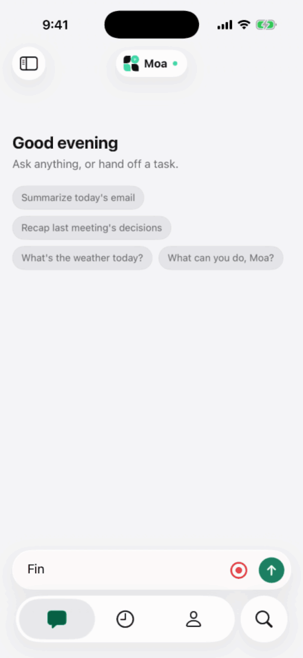
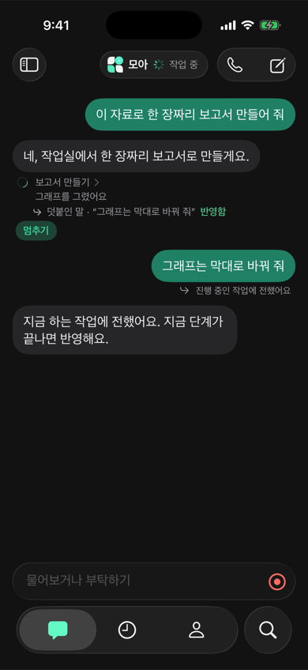
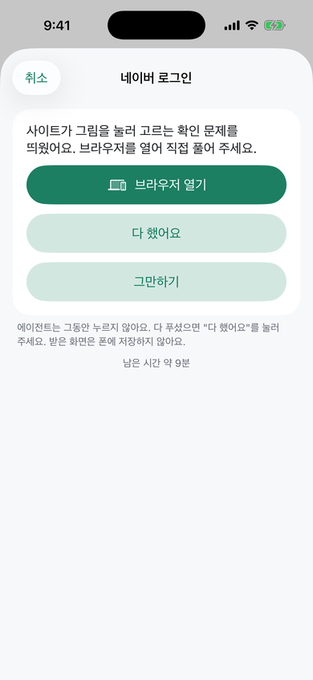
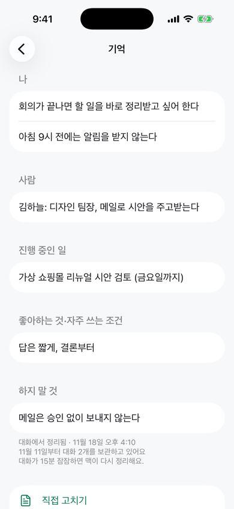

<div align="center">

# moa-ios

**내 맥에서 도는 개인 AI 비서([moa-agent](https://github.com/ijwoo/moa-agent))의 네이티브 iOS 26 (SwiftUI) 앱**

되돌릴 수 없는 일은 해시로 고정해 폰에서 승인하고, 캡차는 폰 화면으로 넘겨 직접 풉니다.
기기 안 회의 녹음·전사부터 실제 할 일 실행까지 한 앱에서 이어집니다.

[English](README.md) · 한국어

[](LICENSE)
[-black.svg)](#빌드)
[](https://github.com/ijwoo/moa-agent)

<br/>

<picture>
  <source media="(prefers-color-scheme: dark)" srcset="docs/media/moa-demo-dark.gif">
  
</picture>

<sub>아이폰에서 요청 → 맥 브라우저가 작업 → 캡차에서 멈춤 → 폰으로 실시간 화면 전달 → 해결 후 이어서 완료.</sub>

</div>

---

## 주요 기능

- **해시 고정 승인 카드** — 메일 발송이나 되돌릴 수 없는 버튼 클릭은 항상 폰 승인을 거칩니다. 승인한 초안은 SHA-256 해시로 고정돼 화면이 바뀌면 실행하지 않습니다.
- **실시간 손 넘기기** — 캡차·2단계 인증을 무리하게 우회하지 않고, 맥 브라우저 화면을 폰으로 넘겨 사람이 직접 풉니다.
- **작업 중 끼어들기** — 작업이 도는 동안 일상 대화를 하거나 *"그래프는 막대로 바꿔 줘"*처럼 중간에 방향을 바꿀 수 있습니다.
- **아이폰 키체인 + Face ID** — 로그인 값은 맥에 저장하지 않고 아이폰 키체인에 보관합니다.
- **회의 녹음 → 실행 파이프라인** — 녹음과 받아쓰기는 **기기 안에서만** 처리하고(음성 외부 전송 없음), 요약된 결정·할 일을 바로 맥 에이전트 작업으로 넘깁니다.

| 작업 중 끼어들기 | 로그인 중 사람 확인 | 기억 화면 |
|:---:|:---:|:---:|
|  |  |  |

---

## 맥 서버 없이 바로 둘러보기 (데모 모드)

맥 서버를 띄우지 않아도 **Xcode › Scheme › Run › Arguments**에 아래 인자를 넣으면 가짜 데이터로 주요 흐름을 바로 실행해 볼 수 있습니다.

| 보고 싶은 화면 | 실행 인자 |
|---|---|
| **전체 데모 흐름** | `-demo -demoAgent -demoHandover -demoNewChat -demoReel "가상몰에서 무선 이어폰 최저가 찾아줘"` |
| **작업 중 끼어들기** | `-demo -demoAgent -demoNewChat -demoReport -demoSteer -demoAsk "한 장짜리 보고서 만들어 줘" -demoSteerSay "그래프는 막대로 바꿔 줘"` |
| **기억 화면** | `-demo -demoAgent -demoTab profile -demoProfileScreen memory -demoMemory` |

`-demoEnglish`를 함께 넣으면 위 GIF처럼 데모 화면이 영어로 나옵니다(영어 README의 명령).

---

## 빌드

필요한 것: **Xcode 26 (iOS 26 SDK)**, **[XcodeGen](https://github.com/yonaskolb/XcodeGen)**

```sh
cp Config/Secrets.xcconfig.example Config/Secrets.xcconfig   # 데모 모드는 비워 둬도 빌드됨
xcodegen generate
open MeetingSummary.xcodeproj
```

- 실기기 서명 시 `project.yml`의 `DEVELOPMENT_TEAM`과 `bundleIdPrefix`를 본인 것으로 변경하세요.
- WeatherKit / Push Notifications 권한이 없으면 `project.yml`의 `entitlements`에서 빼면 됩니다.
- 테스트: `xcodebuild test -project MeetingSummary.xcodeproj -scheme MeetingSummary -destination 'platform=iOS Simulator,name=iPhone 17 Pro'`

<details>
<summary>선택: 회의 요약 중계 서버 실행</summary>

```sh
cd proxy
cp .env.example .env   # ANTHROPIC_API_KEY, APP_TOKEN 설정
npm install && npm start
```

앱의 `Config/Secrets.xcconfig`에 `PROXY_HOST`와 `PROXY_APP_TOKEN`을 입력합니다.

</details>

---

## 문서

- [아키텍처](docs/ARCHITECTURE.md) — 앱 모듈, Tailscale 연동, 중계 서버 구조
- [결정 기록](docs/DECISIONS.md) — 약 150개의 설계·UX 결정 기록 (`D번호`)

## 라이선스

[MIT](LICENSE)
