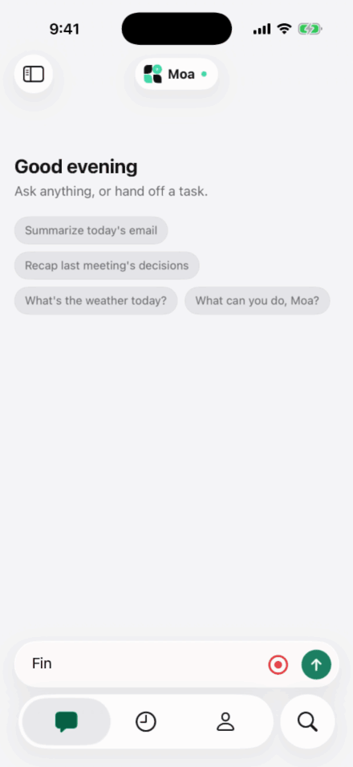
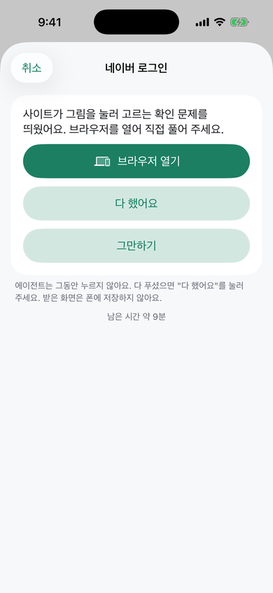

# 모아 (Moa) — 내 맥에서 도는 개인 비서의 아이폰 앱

<p align="center"></p>

> 30초 데모: 명령을 보내면 맥의 브라우저가 대신 일하다가, 사람 확인(캡차) 화면을 만나면 멈추고 그 화면을 폰으로 넘깁니다. 사람이 폰에서 직접 풀고 "다 했어요"를 누르면 이어서 하고, 결과를 카드로 돌려줍니다. (영상의 가게·값·사이트는 모두 지어낸 것입니다)

**English summary** — Moa is an iOS 26 SwiftUI app that drives a personal agent running on your own Mac (over Tailscale). The agent browses and acts for you; anything irreversible needs your approval on the phone (approved drafts are pinned by hash), and when it hits a human check it hands the live screen to your phone so *you* solve it. It also records meetings with on-device transcription and answers questions about them with citations.

## 무엇을 하나요

- **맥에 일 맡기기**: 폰에서 말로 시키면 집에 있는 맥의 에이전트가 브라우저로 대신 찾고, 결과를 답변 카드로 돌려줍니다.
- **되돌릴 수 없는 일은 폰에서 승인**: 메일 보내기, 사이트의 단추 누르기 같은 일은 항상 승인 카드를 거칩니다. 승인한 초안은 해시로 고정돼서, 승인한 것과 다르면 맥이 실행하지 않습니다.
- **사람 확인은 사람이**: 에이전트는 캡차를 풀지 않습니다. 그 화면을 폰으로 넘겨 받아 직접 누르고 씁니다(손 넘기기).
- **작업 중에도 대화**: 작업이 도는 동안 일상 대화를 하고, "이렇게 바꿔 줘"로 끼어들 수 있습니다. 서로 다른 일은 함께 돌아갑니다.
- **사이트 로그인**: 로그인 값은 맥에 남기지 않고, 원하면 이 아이폰의 키체인에 두었다가 Face ID로 꺼내 씁니다.
- **기억**: 맥이 대화에서 정리한 요약을 보고, 고치고, 되돌리고, 지난 대화를 찾을 수 있습니다.
- **회의 기록**: 녹음을 기기 안에서 받아쓰고(음성은 서버로 보내지 않음), 결정 사항·할 일로 요약해 미리알림에 넣습니다. 지난 회의에 질문하면 근거가 된 발언으로 바로 갑니다.
- **에이전트에게 전화**: 통화하듯 말로 주고받습니다(듣기는 기기 안 음성 인식).
- **내 공간**: 말한 대로 카드(메일·날씨·오늘 일정·예약 결과 등)를 모아 두는 탭입니다. "나" 탭에서 켠 사람에게만 보이고, 처음 화면의 "내 공간 시작하기"로도 켤 수 있습니다.
- **홈 화면 위젯**: 내 공간의 카드를 홈 화면에 보여 줍니다. 누르면 내 공간 탭이 열리고(`moa://space`), 맥에 닿지 못하면 지난 모습을 보여 줍니다.
- **알림**: 맥이 보내는 알림(승인 대기, 예약 결과, 로그인이 풀린 사이트 등)을 받습니다. 알림 확장이 정해진 문장과 번호만 받아 맥에 직접 물어 실제 글로 바꿉니다.

| 작업 중 끼어들기 | 로그인 중 사람 확인 | 기억 |
|---|---|---|
|  |  |  |

## 구조

```
아이폰 (이 저장소)  ──Tailscale──▶  맥 에이전트 (moa-agent)  ──▶  브라우저 · 작업실 · 모델
        │
        └──HTTPS──▶  중계 서버 (proxy/, 회의 요약·질문용, API 키는 서버에만)
```

- 맥 에이전트: [ijwoo/moa-agent](https://github.com/ijwoo/moa-agent) ([설치](https://github.com/ijwoo/moa-agent#설치-맥)) — 맥 기능은 그쪽이 알려 주는 기능(`/v1/health`의 features)이 있을 때만 켜집니다.
- 설계 문서: [docs/ARCHITECTURE.md](docs/ARCHITECTURE.md) (화면 구성은 아래 "앱 구성"이 더 최신입니다)
- 결정 기록: [docs/DECISIONS.md](docs/DECISIONS.md) — 무엇을 왜 그렇게 정했는지 150개 남짓의 기록

### 앱 구성

아래 탭 막대는 대화 · 내 공간 · 활동 · 나 · 검색(오른쪽에 떨어진 탭)입니다.

| 탭 | 하는 일 |
|---|---|
| 대화 | 입력창 하나로 맥에 부탁하거나 지난 회의에 묻습니다. 왼쪽 위 버튼으로 사이드바(새 대화, 맡길 수 있는 일, 에이전트 작업, 예약, 최근 대화)를 열고, 입력창 옆 녹음 버튼으로 회의를 녹음합니다. |
| 내 공간 | 카드 모음. "나" 탭에서 켰을 때만 보입니다. 할 일 전체 목록은 카드의 "전체 보기"로 엽니다. |
| 활동 | 맥이 한 일을 보는 탭. 회의 목록도 여기서 열 수 있습니다. 내가 처리해야 할 일(승인·질문 대기)이 있으면 탭에 개수가 배지로 보입니다. |
| 나 | 화면 모드·강조색·답변 말투·내 공간 켜기, 연동 센터(브라우저 로그인·메일 계정), 기억, 예약, 권한, 데이터 처리 방식. |
| 검색 | 회의·대화·할 일 검색. |

앱에는 두 개의 확장이 함께 담깁니다: 홈 화면 위젯(`MoaWidget/`)과 알림 확장(`NotificationService/`). 두 확장 모두 앱과 같은 맥 주소·토큰으로 맥에 직접 물어봅니다.

## 맥 없이 둘러보기

Debug 빌드는 가짜 맥(지어낸 데이터)으로 화면을 볼 수 있습니다. Xcode의 Scheme › Run › Arguments에 넣으세요.

| 보고 싶은 것 | 실행 인자 |
|---|---|
| 데모 영상과 같은 흐름 | `-demo -demoAgent -demoHandover -demoNewChat -demoReel "가상몰에서 무선 이어폰 최저가 찾아줘"` |
| 작업 중 끼어들기 | `-demo -demoAgent -demoNewChat -demoReport -demoSteer -demoAsk "이 자료로 한 장짜리 보고서 만들어 줘" -demoSteerSay "그래프는 막대로 바꿔 줘"` |
| 기억 화면 | `-demo -demoAgent -demoTab profile -demoProfileScreen memory -demoMemory` |

## 빌드

필요한 것: Xcode 26(iOS 26 SDK), [XcodeGen](https://github.com/yonaskolb/XcodeGen)

```sh
cp Config/Secrets.xcconfig.example Config/Secrets.xcconfig   # 값은 비워 둬도 빌드된다
xcodegen generate
open MeetingSummary.xcodeproj
```

- `project.yml`의 `DEVELOPMENT_TEAM`에 내 팀 ID를, `bundleIdPrefix`(`com.example`)를 내 것으로 바꿉니다.
- 날씨 카드(WeatherKit)와 알림(Push Notifications)은 앱 ID에 그 기능을 켜야 서명됩니다. 쓰지 않으면 `project.yml`의 `entitlements` 항목에서 빼세요.
- 테스트: `xcodebuild test -project MeetingSummary.xcodeproj -scheme MeetingSummary -destination 'platform=iOS Simulator,name=iPhone 17 Pro'`

### 중계 서버 (회의 요약·질문)

```sh
cd proxy
cp .env.example .env   # ANTHROPIC_API_KEY, APP_TOKEN 등을 채운다
npm install && npm start
```

앱의 `Config/Secrets.xcconfig`에 서버 주소(`PROXY_HOST`)와 같은 `APP_TOKEN`(`PROXY_APP_TOKEN`)을 넣습니다.

`.env`의 `SUMMARY_MODEL`로 요약 모델을 고릅니다(예시 파일에 후보가 적혀 있습니다). Node 22 이상이 필요하고, 테스트는 `npm test`입니다.

### 맥 에이전트 연결

맥 기능을 쓰려면 `Config/Secrets.xcconfig`에 맥 에이전트의 주소(`AGENT_HOST`)와 앱 토큰(`AGENT_APP_TOKEN`)도 넣습니다. 비워 두면 맥 기능 없이 회의 기록·요약만 쓸 수 있습니다. 홈 화면 위젯과 알림 확장도 같은 값을 읽으므로 따로 설정할 것은 없습니다.

## 지키는 것

- 실제 회의 내용·이름·로그인 값은 저장소와 로그에 남기지 않습니다. 화면과 데모는 지어낸 데이터로 만듭니다.
- 녹음과 받아쓰기는 기기 안에서만 합니다. 서버로 가는 것은 요약에 필요한 글뿐입니다.
- 맥이 보낸 화면(손 넘기기, 작업 캡처)은 메모리에서만 그리고 저장하지 않습니다.

## 라이선스

[MIT](LICENSE)
