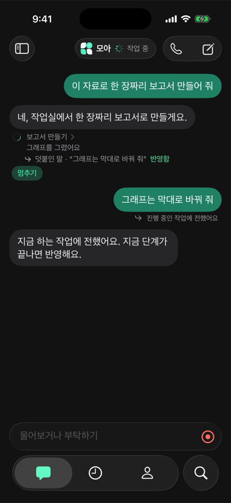
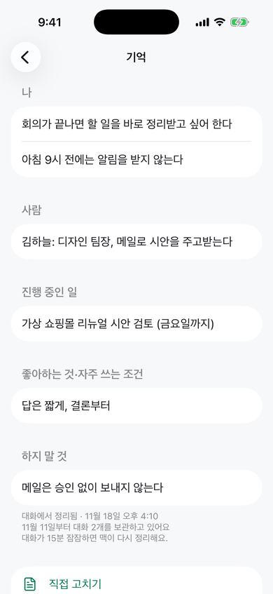

<div align="center">

# moa-ios

**Native iOS 26 (SwiftUI) client for your self-hosted Mac AI assistant ([moa-agent](https://github.com/ijwoo/moa-agent)).**

Approve irreversible actions by hash, solve CAPTCHAs live on your phone screen, and turn on-device meeting recordings into real actions.

English · [한국어](README.ko.md)

[](LICENSE)
[-black.svg)](#build)
[](https://github.com/ijwoo/moa-agent)

<br/>

<picture>
  <source media="(prefers-color-scheme: dark)" srcset="docs/media/moa-demo-dark.gif">
   live handover -> result card">
</picture>

<sub>Send a task from iPhone → your Mac browses → pauses at CAPTCHA → streams live screen to your phone → resumes when done.</sub>

</div>

---

## Key Features

- **Hash-Pinned Approval Cards** — Sending emails or clicking irreversible buttons always pauses for your tap. Drafts are pinned by SHA-256 hash so execution aborts if page state changes.
- **Live Browser Handover** — Instead of brittle CAPTCHA bypasses, the Mac agent hands the live browser view to your phone screen so you solve it naturally.
- **Steer While Running** — Chat normally or steer an in-flight task (*"use a bar chart instead"*) without canceling it.
- **iPhone Keychain + Face ID** — Site credentials stay in your iPhone Keychain, never stored on the Mac server.
- **Meeting -> Action Pipeline** — Records and transcribes audio **on-device** (audio never leaves your phone), extracts decisions/todos, and lets the Mac agent act on them.

| Steer In-Flight Tasks | Live Login Handover | Editable Memory |
|:---:|:---:|:---:|
|  |  |  |

---

## Try It Without a Mac Server (Demo Mode)

No Mac server setup required to inspect the UI and flows. Add any of these launch arguments in **Xcode › Scheme › Run › Arguments**:

| Flow | Launch Arguments |
|---|---|
| **Full Demo Reel** | `-demo -demoAgent -demoHandover -demoNewChat -demoEnglish -demoReel "Find the lowest price for wireless earbuds"` |
| **Live Task Steering** | `-demo -demoAgent -demoNewChat -demoEnglish -demoReport -demoSteer -demoAsk "Make a 1-page report" -demoSteerSay "Switch to a bar chart"` |
| **Memory Screen** | `-demo -demoAgent -demoEnglish -demoTab profile -demoProfileScreen memory -demoMemory` |

`-demoEnglish` shows these demo flows in English, as in the GIF above. The app itself is in Korean.

---

## Build

Requires **Xcode 26 (iOS 26 SDK)** and **[XcodeGen](https://github.com/yonaskolb/XcodeGen)**.

```sh
cp Config/Secrets.xcconfig.example Config/Secrets.xcconfig   # Leave empty for demo mode
xcodegen generate
open MeetingSummary.xcodeproj
```

- Update `DEVELOPMENT_TEAM` and `bundleIdPrefix` in `project.yml` before signing for a physical device.
- Remove WeatherKit / Push Notifications from `project.yml` entitlements if you do not enable those capabilities.
- Tests: `xcodebuild test -project MeetingSummary.xcodeproj -scheme MeetingSummary -destination 'platform=iOS Simulator,name=iPhone 17 Pro'`

<details>
<summary>Optional: Meeting Summary Proxy Server</summary>

```sh
cd proxy
cp .env.example .env   # Set ANTHROPIC_API_KEY and APP_TOKEN
npm install && npm start
```

Set `PROXY_HOST` and `PROXY_APP_TOKEN` in `Config/Secrets.xcconfig`.

</details>

---

## Documentation

- [Architecture](docs/ARCHITECTURE.md) — App modules, Tailscale bridge, and proxy flow
- [Decision Log](docs/DECISIONS.md) — ~150 engineering & UX decisions (`D-numbers`)

## License

[MIT](LICENSE)
